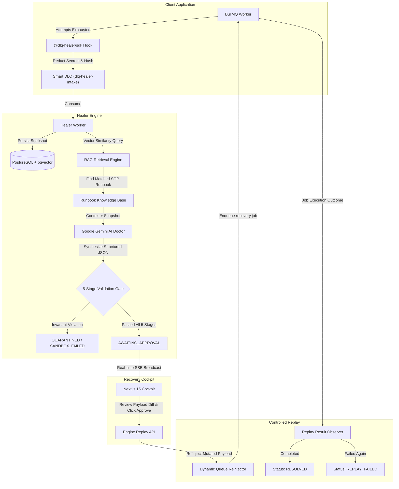

# LazarQ 🛡️⚡

> **Self-Hosted, AI-Assisted Queue Failure Recovery Platform**  
> Automatically captures terminal BullMQ failures, matches remediation runbooks via vector embeddings (`pgvector`), diagnoses root causes using Google Gemini, validates mutations through a 5-stage deterministic sandbox gate, executes controlled replays, and streams real-time updates to an operational recovery cockpit.

---

## 🌟 Overview & Why LazarQ?

In distributed asynchronous systems, Dead Letter Queues (DLQs) frequently become **graveyards of lost customer revenue**:
- **Transient Glitches** (e.g., downstream Twilio/Stripe rate limits) stall orders that could easily succeed with backoff or fallback channels.
- **Payload Schema Bugs** (e.g., missing fields from legacy API clients) sit abandoned because diagnosing each failure requires manual log correlation and database surgery.
- **Manual Retries Are Dangerous**: Blindly replaying poisoned jobs can trigger cascading failure storms, double-charge customers, or corrupt immutable identifiers.

**LazarQ** transforms dead-letter queues into an **autonomous self-healing recovery loop** governed by strict safety invariants:

```text
┌─────────────────┐      Terminal Failure       ┌────────────────────────┐
│ Worker Process  │────────────────────────────►│  @dlq-healer/sdk Hook   │
│ (Order Queue)   │                             │  • Strips PII / Secrets│
└─────────────────┘                             │  • Dedup Key Hash      │
         ▲                                      └───────────┬────────────┘
         │                                                  │ Enqueues
         │ Re-injected Payload                              ▼
         │                                      ┌────────────────────────┐
         │                                      │   dlq-healer-intake    │
         │                                      │ (Internal Smart DLQ)   │
         │                                      └───────────┬────────────┘
         │                                                  │ Consumed by
         │                                                  ▼
┌────────┴────────┐      Approved Plan          ┌────────────────────────┐
│ Queue           │◄────────────────────────────│  Engine AI Doctor      │
│ Reinjector      │                             │  • pgvector RAG Match  │
│ + Replay Tracker│                             │  • Structured Proposal │
└─────────────────┘                             │  • 5-Stage Sandbox Gate│
                                                └────────────────────────┘
```

---

## 📐 Architecture & Lifecycle Flow



---

## 🏛️ The 7 Implementation Rules (Project Constitution)

1. **No Lost Events**: Failures are captured at the worker boundary and persisted before any triage attempt. If the AI engine is down, snapshots accumulate safely in the Smart DLQ queue.
2. **No Replay Without Validation & Authorization**: AI proposals are **never** executed directly. Every mutation must pass a 5-stage deterministic validation gate and receive human approval.
3. **No Premature Resolution**: An incident is marked `RESOLVED` **only** after the re-injected job executes successfully in the destination worker and emits a verified BullMQ `completed` event.
4. **No Duplicate Processing by Assumption**: Deterministic composite idempotency keys (`queueName:jobId:attemptsMade`) prevent duplicate ingestion and replay loops.
5. **No Public Redis Exposure**: Redis credentials remain internal; the dashboard communicates exclusively with the Engine REST API via secure API keys.
6. **No Misleading Metrics**: Operational dashboards calculate genuine aggregates from database transactions (`count()`, `groupBy()`, duration deltas), avoiding vanity numbers.
7. **No SaaS Complexity Before MVP**: Clean, reproducible monorepo that runs locally via Docker Compose with zero cloud lock-in.

---

## 🛡️ The 5-Stage Deterministic Validation Gate

Before any AI-generated proposal can be approved or replayed, it must pass through an automated sandbox gate (`apps/engine/src/sandbox/`):

| Stage | Name | Verification Purpose |
|---|---|---|
| **Stage 1** | **Schema Validation** | Validates that the proposed payload adheres to valid JSON schema formats. |
| **Stage 2** | **Invariant Protection** | Strictly ensures immutable business fields (`orderId`, `userId`, `amount`, `currency`) have **not** been modified, deleted, or forged. |
| **Stage 3** | **Mutation Whitelist** | Verifies that only explicitly permitted fields (e.g., `channel`, `timeoutMs`, `priority`) were altered. |
| **Stage 4** | **Replay Limit Guard** | Enforces maximum recovery attempt ceilings (default: 1 replay) to prevent cascading infinite replay loops. |
| **Stage 5** | **Dry-Run Boundary** | Ensures the re-injected payload does not re-introduce known poison pill properties. |

---

## 📦 Monorepo Structure

```text
lazarQ/
├── apps/
│   ├── engine/                    # Core Healer Engine (Express + BullMQ + Prisma)
│   │   ├── src/
│   │   │   ├── api/               # REST Endpoints (Incidents, Runbooks, Metrics, SSE)
│   │   │   ├── middleware/        # API Key Auth, Error Handler
│   │   │   ├── sandbox/           # 5-Stage Validation Gate & Invariant Checkers
│   │   │   ├── services/          # Triage, RAG (pgvector), Gemini LLM, Metrics, Replay
│   │   │   │   └── replay.service.ts # Dynamic Queue Re-injector
│   │   │   └── workers/           # Healer Intake Worker & Replay Result Observer
│   │   └── tests/                 # 73 Unit, Integration, & E2E Scenarios (Vitest)
│   │
│   ├── dashboard/                 # Next.js 15 App Router + Tailwind CSS Cockpit
│   │   ├── src/app/               # Overview Cockpit, Incidents, Runbooks, System
│   │   └── src/lib/               # SSE Hook, REST API Client, Types
│   │
│   └── playground/                # Simulated Production Environment
│       └── src/
│           ├── demo-self-heal.ts  # Reproducible Interactive Live Recovery Script
│           ├── queues/            # order-fulfillment-queue
│           ├── workers/           # order.worker.ts with @dlq-healer/sdk attached
│           └── seed-jobs.ts       # Bulk failure injection suite (90 jobs)
│
├── packages/
│   └── sdk/                       # @dlq-healer/sdk
│       └── src/
│           ├── attach.ts          # attachDLQHealer(worker, options)
│           ├── redaction.ts       # PII & Secret Redaction Engine
│           └── publisher.ts       # BullMQ intake queue publisher
│
├── prisma/
│   ├── migrations/                # Versioned PostgreSQL + pgvector baseline migrations
│   └── schema.prisma              # Incident, Runbook, RecoveryAttempt, AuditLog
├── .github/workflows/ci.yml       # Automated build, lint, test, and Docker CI pipeline
├── docker-compose.yml             # Local PostgreSQL 16 (pgvector) + Redis 7 Alpine
├── docker-compose.prod.yml        # Full-stack production Compose (Postgres, Redis, Engine, Dashboard)
├── turbo.json                     # Turborepo task pipeline
└── package.json                   # Monorepo root scripts
```

---

## 🚀 Quickstart Guide

### 1. Prerequisites
- **Node.js**: `v20.x` or `v22.x`
- **pnpm**: `v9.x` or `v10.x`
- **Docker & Docker Compose**: For PostgreSQL (with `pgvector`) and Redis.
- **Gemini API Key**: Free key from [Google AI Studio](https://aistudio.google.com/).

### 2. Clone & Install
```bash
git clone https://github.com/Anivesh91/lazarQ.git
cd lazarQ
pnpm install
```

### 3. Environment Configuration
Copy `.env.example` to `.env` and `apps/engine/.env`:
```bash
cp .env.example .env
cp .env.example apps/engine/.env
```
Ensure your Gemini API key is configured in `.env`:
```ini
LLM_PROVIDER="gemini"
LLM_API_KEY="your-gemini-api-key"
EMBEDDING_PROVIDER="gemini"
EMBEDDING_API_KEY="your-gemini-api-key"
ENGINE_API_KEY="dlq_dev_secret_key"
ENGINE_URL="http://localhost:5000"
DASHBOARD_OPERATOR_PASSWORD="replace-with-a-strong-operator-password"
DASHBOARD_SESSION_SECRET="replace-with-at-least-32-random-characters"
```
Set a strong operator password and a unique session secret of at least 32 characters before starting the dashboard. Sign in at `/login`; the dashboard uses an HttpOnly, signed operator session for Engine proxy requests.
Configure these server-only values in `apps/dashboard/.env.local` as well as the Engine API key used by the Engine service:
```ini
ENGINE_URL="http://localhost:5000"
ENGINE_API_KEY="same-value-as-the-engine"
DASHBOARD_OPERATOR_PASSWORD="your-strong-operator-password"
DASHBOARD_SESSION_SECRET="a-unique-random-secret-of-at-least-32-characters"
```

### 4. Start Infrastructure Containers
```bash
docker compose up -d
```
*Verifies PostgreSQL on port `5432` and Redis on port `6379`.*

### 5. Run Database Migrations & Seed SOP Runbooks
```bash
pnpm db:migrate:deploy
pnpm --filter @dlq-healer/engine seed:runbooks
```
*Applies Prisma PostgreSQL/pgvector migrations (or use `pnpm db:push` during rapid schema prototyping) and seeds standard troubleshooting Runbooks with 768-dimensional vector embeddings.*

---

## 🎬 Running the Live Self-Healing Demo

Experience the full autonomous loop in **~5 seconds** directly in your terminal:

```bash
pnpm demo
```

### What the demo executes:
1. **Verifies Infrastructure**: Tests PostgreSQL vector store and Redis.
2. **Injects Production Order**: Adds job to `order-fulfillment-queue` with channel `SMS` and secret token attached.
3. **Exhausts Retries**: Worker fails 3 times due to Twilio Rate Limit (`Error 20429`).
4. **SDK Interception**: `@dlq-healer/sdk` redacts `secretApiKey` and pushes snapshot to `dlq-healer-intake`.
5. **RAG & AI Triage**: Matches Twilio SOP via `pgvector` &rarr; Gemini prescribes `channel: "SMS" -> "EMAIL"`.
6. **5-Stage Gate Passes**: Invariants (`orderId`, `userId`, `amount`) are strictly preserved.
7. **Controlled Replay**: Re-injects repaired job &rarr; Worker fulfills order via Email &rarr; Status becomes **`RESOLVED`**!

---

## 💻 Running the Full Ecosystem

Start all services (Dashboard, Engine, and Playground) concurrently with Turborepo:

```bash
pnpm dev
```

- **Dashboard Cockpit**: [http://localhost:3000](http://localhost:3000)
- **Engine REST API**: [http://localhost:5000](http://localhost:5000)
- **API Health Check**: [http://localhost:5000/health](http://localhost:5000/health)

### Inject 90 Realistic Terminal Failures
To simulate a heavy production incident spike across 3 failure categories:
```bash
pnpm --filter @dlq-healer/playground seed
```
- 30 Rate-limit errors (`Twilio 20429`)
- 30 Schema bugs (Missing `userId`)
- 30 Infrastructure glitches (Connection pool timeout)

Watch them stream live into the Next.js Cockpit via real-time Server-Sent Events (SSE)!

---

## 🐳 Production Docker Deployment

Run the entire stack (PostgreSQL with `pgvector`, Redis, Engine API, and standalone Next.js Cockpit) in containers:

```bash
docker compose -f docker-compose.prod.yml up -d --build
```

- **Engine Migration Hook**: `apps/engine/docker-entrypoint.sh` automatically runs `prisma migrate deploy` when `RUN_MIGRATIONS=true` (default in `docker-compose.prod.yml`). Set `SEED_RUNBOOKS=true` on first boot to populate the default SOP runbooks.
- **Standalone Dashboard Build**: `apps/dashboard/Dockerfile` sets `NEXT_OUTPUT_STANDALONE=true` to emit a minimal standalone Next.js server while preserving fast native local builds.
- **HTTPS Cookie Flag**: When deploying behind an HTTPS reverse proxy, set `DASHBOARD_COOKIE_SECURE=true` so operator session cookies always carry the `Secure` attribute.

---

## 📚 API Reference

All protected endpoints require the `x-api-key` header (configured via `ENGINE_API_KEY`).

| Method | Endpoint | Description | Auth |
|---|---|---|---|
| `GET` | `/health` | Engine health, Redis, PostgreSQL & Circuit Breaker status | Public |
| `GET` | `/api/events` | Real-time Server-Sent Events (SSE) lifecycle stream | Required |
| `GET` | `/api/incidents` | Query incidents with queue, status, and pagination filters | Required |
| `GET` | `/api/incidents/:id` | Full incident details with AI diagnosis, diff & SOP citation | Required |
| `POST` | `/api/incidents/:id/approve` | Approve proposal & trigger dynamic queue re-injection | Required |
| `POST` | `/api/incidents/:id/reject` | Quarantine incident with reason | Required |
| `GET` | `/api/incidents/:id/recoveries` | Recovery execution attempts | Required |
| `GET` | `/api/incidents/:id/history` | Chronological audit log history | Required |
| `GET` | `/api/runbooks` | List troubleshooting SOP runbooks | Required |
| `POST` | `/api/runbooks` | Create runbook + generate 768-dim vector embedding | Required |
| `PATCH` | `/api/runbooks/:id` | Update runbook metadata or re-embed SOP content | Required |
| `DELETE` | `/api/runbooks/:id` | Delete runbook | Required |
| `GET` | `/api/metrics` | Database-calculated operational metrics & resolution rates | Required |

---

## 🧪 Automated Test Suite

LazarQ maintains rigorous test coverage spanning unit, integration, and full end-to-end scenarios:

```bash
pnpm test
```

```text
packages/sdk/tests/redaction.test.ts      (4 tests)
packages/sdk/tests/attach.test.ts          (2 tests)
apps/engine/tests/api.test.ts              (9 tests)
apps/engine/tests/circuit-breaker.test.ts  (9 tests)
apps/engine/tests/embedding.test.ts        (3 tests)
apps/engine/tests/events.test.ts           (3 tests)
apps/engine/tests/incident.test.ts         (4 tests)
apps/engine/tests/metrics.test.ts          (2 tests)
apps/engine/tests/rag.test.ts              (5 tests)
apps/engine/tests/recovery.test.ts         (15 tests)
apps/engine/tests/runbook.test.ts          (8 tests)
apps/engine/tests/triage.test.ts           (5 tests)
apps/engine/tests/validator.test.ts        (7 tests)
apps/engine/tests/e2e.test.ts              (3 tests)

Test Suites: 14 total (12 Engine, 2 SDK)
Total Tests: 79 total (73 Engine, 6 SDK)
```

---

## 🔍 Honest Limitations & Production Considerations

1. **At-Least-Once Delivery**: BullMQ operates on at-least-once delivery semantics. Consumer workers must design idempotency handlers using external unique constraints (e.g. idempotency keys on payment transactions).
2. **LLM Hallucinations vs. Deterministic Gates**: LLMs are creative by design. LazarQ prevents rogue mutations by strictly subordinating LLM proposals to the **5-Stage Deterministic Sandbox Gate**. If an LLM suggests changing an order amount or fabricating an ID, the gate immediately marks the proposal `SANDBOX_FAILED`.
3. **Dual-Write Concurrency**: To prevent race conditions where a fast worker completes a replayed job before the database records the attempt, the Engine persists the `IN_PROGRESS` attempt record *before* enqueuing to BullMQ.
4. **Single-Node vs. Clustered Redis**: Dynamic queue reinjection pools connections per queue. In a multi-tenant Redis Cluster setup, queue key hashing tags (`{queue-name}`) should be enforced across BullMQ configurations.

---

## 📄 License
MIT © 2026 LazarQ Contributors.
